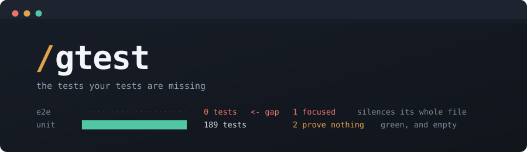
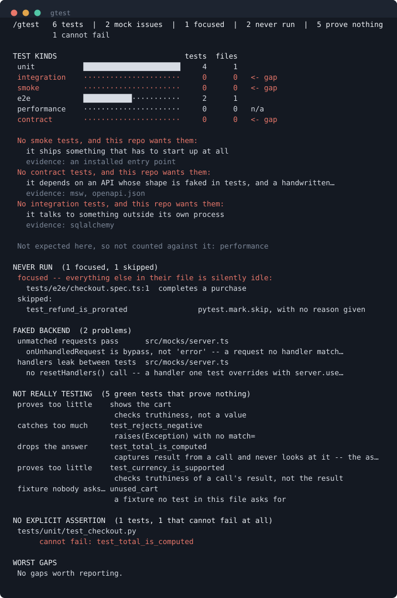

<div align="center">



**The tests your tests are missing.**

[](#tests)
[](#tests)
[](#design)
[](#thirty-seconds-to-a-verdict)
[](LICENSE)

*a kind of test you have none of · a test that cannot fail · an `it.only` silencing its file ·
a fake backend that passes a dead route · an assertion that proves nothing*


[See it](#see-it) · [Why](#green-does-not-mean-tested) · [Install](#thirty-seconds-to-a-verdict) · [What it finds](#what-it-finds) · [Languages](#languages) · [Design](#design)

</div>

A Claude Code plugin for developers, SDETs and QA. `/gtest` scans a repo and
draws **one diagram in the terminal**.

## See it



That is a real run on a sample repo — `docs/make_demo.py` turns the tool's own
text output into the picture, so it cannot drift from what the tool does.

In one screen: three kinds of test this repo should have and does not, an
`it.only` silencing its file, a skip with no reason, two ways the faked
backend cannot fail, and five tests that are green and empty.

## Green does not mean tested

Your pipeline is green. It has been green for three weeks.

```js
it.only('completes a purchase', async ({ page }) => {
```

One `.only`, committed in March. Forty other tests in that file have not run
since. CI reported green every single time.

```python
def test_total_is_computed():
    result = total([2, 3])
```

The call happens. The answer is thrown away. The line is covered, the test
passes, and `total` could return `None` forever.

```js
beforeAll(() => server.listen({ onUnhandledRequest: 'bypass' }))
```

The backend is faked. A route the real API deleted last month still passes,
because nothing says an unmatched request should fail.

```python
assert result
```

Passes for `1`, for `"error"`, for a half-built object. It proves something
came back. It does not prove it is right.

**None of these show up in a coverage report.** Every one of them shows up
here, in the first screen, with the reason spelled out.

## Thirty seconds to a verdict

```bash
claude plugin marketplace add gouravrana7/gtest
claude plugin install gtest@gtest
```

Then, in any repo:

```
/gtest
```

It reads files and runs nothing, so the first answer is immediate. **Running
your test suite always asks first** — a suite can seed a database, call an API
or take an hour, and this one does not decide that for you.

## What it finds

| You want to know… | It says |
|---|---|
| Is anything untested that matters? | the worst gaps, ranked, each with the function that owns it |
| Do we even have end-to-end tests? | every kind, and whether this repo is the sort that needs it |
| Are these tests any good? | which ones cannot fail, prove too little, or repeat each other |
| Is anything silently not running? | `it.only`, `it.skip`, `xit`, `@pytest.mark.skip` |
| Can our fake backend fail? | msw, responses, respx, vcrpy, spec-less patches |
| Which tests are flaky? | flaky, always-failing and collection-changed, told apart |
| What is slowing CI down? | the slowest tests, from a report you already produce |

### Every finding

| Finding | What it means |
|---|---|
| `gap` | the repo has the shape that wants this kind of test, and has none |
| `focused` | one `it.only` leaves every other test in its file idle while CI reports green |
| `skipped` | a skip, xfail or `it.todo`; one with no reason is one nobody comes back to |
| `always_true` | `assert True`, `expect(1).toBe(1)`, `assertEqual(a, a)` — cannot fail |
| `weak_assertion` | `assert result`, `toBeTruthy()`, `assertIsNotNone` — proves it came back, not that it is right |
| `broad_raises` | `raises(Exception)` or bare `toThrow()` — a typo satisfies it as well as the bug |
| `no_subject` | asserts without touching the project at all |
| `unused_result` | captures a call's result and never looks at it; the assertion belongs there |
| `duplicate` | the same body as another test, usually a copy-paste nobody finished |
| `dead_fixture` | a fixture no test in its file asks for |
| `checks_nothing` | assigns, prints or passes — can never fail |
| `relies_on_no_raise` | a bare call: weaker than an assertion, but it does fail if the call raises |
| `mock_lenient` | msw that does not error on an unmatched request — a dead route still passes |
| `mock_no_reset` | no `resetHandlers()` in `afterEach`; one test's override leaks into the rest |
| `mock_no_spec` | `patch()` with no `autospec`, asserted on — a signature change stays green |
| `mock_unfired` | responses or respx set not to care that a registered mock was never called |
| `mock_rerecords` | vcrpy `record_mode` of `all` — a breaking change is recorded, not caught |
| `flaky` | same code, different answers; reported apart from always-failing, which is a bug |
| `slowest` | the duration was already in the JUnit report, so it is free |

## A gap only counts when the repo asks for it

Reporting every absent kind is noise. A library has no business having
end-to-end tests; a CLI has no API surface for contract tests. So each kind is
decided from evidence in the tree:

| Kind | Expected when |
|---|---|
| unit | always |
| integration | a database, HTTP or queue dependency, or a docker-compose file |
| e2e | a web framework, a browser runner config, a Dockerfile, or an installed entry point |
| smoke | an installed entry point, or a Dockerfile |
| contract | an OpenAPI spec, a `proto/` directory, gRPC, GraphQL, or an HTTP faking library |
| performance | a benchmarking tool is already a dependency |

No evidence reads `n/a`. Evidence with no tests is a gap, and the report prints
the evidence so the verdict can be argued with:

```
 e2e            ······················     0      0   <- gap

 No e2e tests, and this repo wants them:
   it ships something a user starts: a CLI, a server or a page
   evidence: fastapi, Dockerfile
```

Having more kinds than the evidence calls for is never a complaint.

## Usage

```
/gtest              scan and draw: kinds, suspect tests, fakes, runners
/gtest --diff main  only gaps on lines this branch changed
/gtest --flaky 3    three runs compared, plus the slowest tests
/gtest --fix        write tests for the top three gaps
/gtest --all        everything in one pass
```

`/testsweep` and `/sweep` are aliases.

Nothing is deployed or published — a Claude Code plugin is a git repository
with a `marketplace.json` in it, and `marketplace add` clones it.

## Mutation testing

Coverage says a line ran. It cannot say the line was checked.

```
original    if age >= 18:
mutant      if age >  18:
```

Run the suite against the mutant. If nothing fails, that line executes in your
tests and nothing verifies it. A smoke alarm on the wall is not the same as a
smoke alarm that goes off.

Each mutant costs one full test run, so the default is **two**; raise `--limit`
for more. Operators are located with `tokenize`, so a `>` inside a string is
never touched, and a mutant that would not parse is discarded rather than
offered.

## Nothing is modified by a scan

Every script only reads. The single exception is `mutate.py --apply`, which

- refuses unless the file is committed and unmodified, so `--restore` is exact
- puts the file back itself if the write touched more than the one line
- is always followed by `--restore` before the next mutant

That is not a promise in a README — it is a test.
`tests/smoke/test_read_only.py` snapshots a whole fixture repo by file hash,
runs every script in every scan mode against it, and fails if one byte moved
or one file appeared.

## Languages

| | Python | JavaScript / TypeScript | Go, Ruby, others |
|---|---|---|---|
| counted per kind | yes | yes | yes |
| line coverage | yes | yes | Go yes, rest no |
| assertions, tautologies, duplicates | yes | yes | no |
| weak assertions | yes | yes | no |
| focused and skipped | skips | `it.only`, `it.skip`, `xit`, `todo` | no |
| owning function and complexity | yes | yes | no |
| faked-backend checks | mock, responses, respx, vcrpy | msw | no |

Python is read with `ast`. JavaScript and TypeScript are read with a scanner
that understands strings, templates, comments and brace matching — enough to
name the function owning an uncovered line and count its branches, with no
parser dependency, because this plugin ships none.

## Runners

| Runner | Kinds | Coverage |
|---|---|---|
| pytest | unit, integration, smoke, e2e | yes, with `pytest-cov` |
| vitest | unit, integration | yes, with `@vitest/coverage-v8` |
| jest | unit, integration | yes |
| playwright | e2e | yes, once `monocart-reporter` is configured |
| cypress | e2e | yes, with `@cypress/code-coverage` and istanbul |
| go test | unit, integration | yes, `-coverprofile` is parsed |

Where a runner needs wiring before it emits anything, the scan prints what to
add. A browser runner with no reporter produces an empty report, and an empty
report makes the number lie.

Kinds come from the path, not the runner, because most repos drive unit and
end-to-end tests through the same tool.

## Design

Seven scripts parse and draw. None runs a test suite. None writes code.

```
skills/coverage-gaps/
  stacks.py     runners, tests per kind, which kinds the repo asks for
  rank.py       gaps ranked by risk; coverage.py, istanbul and Go adapters
  pysource.py   Python: line to function, complexity, assertions, skips, fakes
  jssource.py   JavaScript and TypeScript: the same, plus it.only
  flaky.py      JUnit across runs: flaky, broken, slow, quarantine args
  mutate.py     small wrongnesses your tests ought to notice
  diagram.py    all of it as one terminal picture
  SKILL.md      the judgment: what matters, which test to write
```

Each carries its own `--self-check`:

```bash
python3 skills/coverage-gaps/jssource.py --self-check
```

### Ranking

Every signal appears in the output, so the order can be argued with:

```
recently changed      +3    git log -20 touched this file
risky path            +2    auth, pay, token, parse, crypt, admin, …
uncovered branches    +2    not just lines
share missed          +0..3
complexity            +0..3  branchiest untested function, capped at 12
```

The weights live in a `WEIGHTS` dict at the top of `rank.py`.

### Safety

- Never runs a test suite without showing the command and getting an answer.
- Never installs a package; prints the install command instead.
- Refuses a coverage report naming a path outside the repo, and does not
  follow symlinks out of it.
- Refuses a JUnit report declaring a DTD or entity, so a crafted report cannot
  exhaust memory.
- Validates git refs before they reach `git`, so `--diff=--upload-pack=...`
  cannot ride in.
- Strips control characters from every value before printing, so a file path
  from a report cannot repaint the terminal.

## Correctness over thoroughness

Every check here earns its place by not crying wolf. Several were narrowed
after running the plugin on real repositories:

- `pytest.raises(Exception)` followed by an assertion on the captured
  exception is not flagged — the message check is the narrowing.
- An assertion on a module constant is a real test, even with no call in it.
- A Playwright test written `async ({ page }) => { ... }` had its destructured
  parameter mistaken for the test body, which made every such test look
  assertion-free.
- A weak assertion sitting beside a strong one is a guard, not a finding.

Where a check could not be made precise, it was not shipped.

## Tests

```bash
python3 -m venv .venv && .venv/bin/pip install pytest pytest-cov
.venv/bin/python -m pytest --cov --cov-report=term-missing
```

Unit tests import the modules, integration tests spawn them as subprocesses,
and smoke tests check the plugin is installable, that every self-check still
passes, and that a scan changes nothing. Coverage is gated at 80% and sits
at 95%.

## Licence

MIT.
